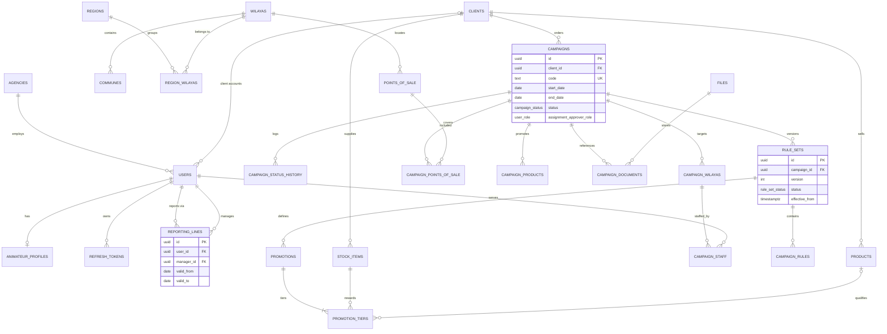
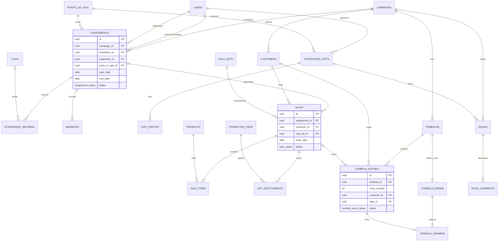
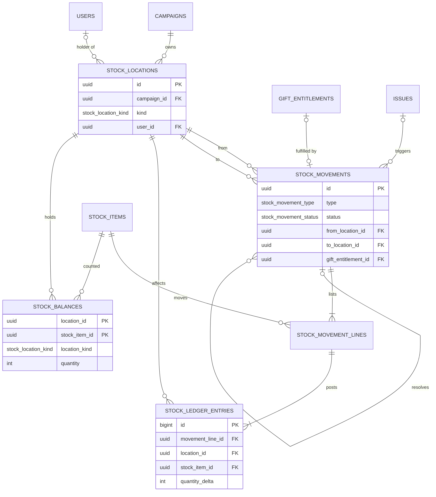

# FieldFlow — المرحلة 4: تصميم قاعدة البيانات

Nov 20, 2026 · @mounir

## الخلاصة

**52 جدولاً في 7 مجالات، مبنية على مبدأ واحد: لا شيء يُمحى ولا شيء يُحسب مرتين.** المخزون دفتر بالقيد المزدوج (كل حركة تخرج من مكان وتدخل آخر)، والتبعية والقواعد والتعيينات مؤرّخة، والمبيعات والحضور يُصحّحان بسجل جديد لا بالتعديل.

### المبادئ

1. **التاريخ لا يُفقد:** الدفاتر (`stock_ledger_entries`، `audit_logs`) محمية بـ Trigger يرفض UPDATE وDELETE.
2. **لا تكرار:** الأرصدة والمؤشرات مشتقة. الاستثناءان المقصودان: `stock_balances` (يُحدَّث في نفس Transaction مع الدفتر، للأداء ولقفل الصف)، ولقطات (snapshots) مثل `supervisor_id` على البيع لأن المشرف يتغيّر.
3. **القاعدة تحمي نفسها:** كل قاعدة عمل يمكن قولها كقيد (رصيد لا يكون سالباً، لا تداخل تعيينات، رقم مشاركة فريد) تُكتب كقيد، لا فقط في Service.
4. **المفاتيح الأجنبية حقيقية:** لا علاقات متعددة الأشكال (polymorphic) إلا في `audit_logs` و`notifications` و`ai_suggestions` حيث المرجع للعرض فقط.
5. **المستأجر في كل مكان:** `agency_id` في كل جدول أعمال، حتى حين يمكن اشتقاقه، ليكون شرط Scope مباشراً ومفهرساً.

### الاتفاقيات المشتركة (لا تُكرّر في الجداول أدناه)

| العمود | النوع | القاعدة |
| --- | --- | --- |
| `id` | `uuid` PK، `DEFAULT gen_random_uuid()` | في كل جدول ما لم يُذكر مفتاح مركّب أو `bigserial` |
| `agency_id` | `uuid` FK → agencies، `NOT NULL` | في كل جدول أعمال (عدا المرجعية: wilayas، communes) |
| `created_at` | `timestamptz NOT NULL DEFAULT now()` | في كل جدول |
| `updated_at` | `timestamptz NOT NULL` | في الجداول القابلة للتعديل فقط (ليس في الدفاتر) |
| `created_by` | `uuid` FK → users | حيث يهم من أنشأ السجل |
| `deleted_at` | `timestamptz NULL` | Soft Delete للبيانات المرجعية فقط: clients، products، stock_items، points_of_sale، regions |
| `version` | `int NOT NULL DEFAULT 1` | Optimistic locking للسجلات التي يعدّلها أكثر من شخص (campaigns، points_of_sale) |

النصوص `text` مع `CHECK (char_length(...) <= n)` بدل `varchar(n)`، والبريد `citext`، والمبالغ `numeric(14,2)` بالدينار، والكميات `integer` (الهدايا والمنتجات وحدات كاملة).

## Enums

الـ Enum في PostgreSQL للقيم التي يعتمد عليها المنطق (حالات، أدوار، أنواع حركة). القيم التي قد تتغيّر برغبة العميل (نوع المحل، فئة المشكلة) `text` مع تحقق Zod.

| Enum | القيم |
| --- | --- |
| `user_role` | `director`، `general_manager`، `regional_manager`، `supervisor`، `animateur`، `client` |
| `user_status` | `active`، `suspended`، `left` |
| `campaign_status` | `draft`، `planning`، `assigned`، `active`، `suspended`، `completed`، `closed`، `cancelled` |
| `rule_set_status` | `draft`، `approved`، `superseded` |
| `rule_type` | `attendance`، `uniform`، `sales_target`، `sampling_target`، `customer_fields`، `daily_report` |
| `promotion_type` | `gift_with_purchase`، `tiered_gift` |
| `campaign_staff_role` | `regional_manager`، `supervisor` |
| `assignment_status` | `proposed`، `approved`، `rejected`، `cancelled` |
| `attendance_status` | `pending`، `verified`، `rejected` |
| `absence_type` | `justified`، `unjustified` |
| `sale_status` | `recorded`، `voided` |
| `entitlement_status` | `pending`، `distributed`، `undelivered`، `cancelled` |
| `stock_item_kind` | `gift`، `sample` |
| `stock_location_kind` | `external`، `warehouse`، `holder`، `in_transit`، `customers`، `losses` |
| `stock_movement_type` | `stock_in`، `transfer`، `distribution`، `return`، `adjustment` |
| `stock_movement_status` | `posted`، `pending`، `confirmed`، `disputed`، `cancelled`، `pending_approval`، `rejected` |
| `tombola_status` | `open`، `closed`، `drawn` |
| `tombola_entry_status` | `valid`، `excluded` |
| `prize_delivery_status` | `pending`، `delivered`، `unreachable` |
| `issue_status` | `open`، `in_progress`، `resolved`، `closed` |
| `file_visibility` | `internal`، `client_visible` |
| `actor_type` | `user`، `system`، `ai_service` |
| `ai_suggestion_status` | `pending_review`، `accepted`، `rejected` |

`tombola` ليس ضمن `promotion_type` لأن له جداول ودورة حياة مستقلة (القسم 8)، ويجتمع مع أي عرض هدية في نفس الحملة.

## الهوية والهيكل والجغرافيا (10 جداول)

### agencies

| العمود | النوع | القيود |
| --- | --- | --- |
| name | text | NOT NULL |
| code | text | UNIQUE، `^[A-Z0-9-]{2,20}$` |
| settings | jsonb | NOT NULL DEFAULT '{}' (المنطقة الزمنية، اللغة الافتراضية) |

### users

| العمود | النوع | القيود |
| --- | --- | --- |
| role | user_role | NOT NULL |
| client_id | uuid FK → clients | NULL؛ `CHECK ((role = 'client') = (client_id IS NOT NULL))` |
| full_name | text | NOT NULL |
| email | citext | NOT NULL، UNIQUE (عالمي لأن الدخول بالبريد قبل معرفة الوكالة) |
| phone | text | NULL، بصيغة E.164 |
| wilaya_id | smallint FK → wilayas | NULL |
| commune_id | int FK → communes | NULL |
| status | user_status | NOT NULL DEFAULT 'active' |
| password_hash | text | NOT NULL (argon2id) |
| must_change_password | boolean | NOT NULL DEFAULT true |
| token_version | int | NOT NULL DEFAULT 0 |
| last_login_at | timestamptz | NULL |
| is_demo | boolean | NOT NULL DEFAULT false |

فهارس: `(agency_id, role, status)`، `(agency_id, wilaya_id)`.

### animateur_profiles

`user_id` PK/FK → users، `experience_years smallint`، `skills text[]`، `languages text[]`، `notes text`. منفصل لأن الحقول خاصة بدور واحد؛ السجل السابق والغيابات مشتقة من assignments وattendance.

### refresh_tokens

| العمود | النوع | القيود |
| --- | --- | --- |
| user_id | uuid FK → users | NOT NULL، ON DELETE CASCADE |
| family_id | uuid | NOT NULL، فهرس |
| token_hash | text | UNIQUE |
| expires_at | timestamptz | NOT NULL |
| revoked_at | timestamptz | NULL |
| replaced_by_id | uuid FK → refresh_tokens | NULL |
| ip / user_agent | inet / text | NULL |

### wilayas و communes (بيانات مرجعية محمّلة بـ Seed)

- `wilayas`: `id smallint` PK (الرمز الرسمي)، `name_ar`، `name_en`. بدون `agency_id`.
- `communes`: `id int` PK، `wilaya_id` FK، `name_ar`، `name_en`. فهرس `(wilaya_id)`.

### regions و region_wilayas

- `regions`: `name`، `code`، `deleted_at`. UNIQUE `(agency_id, code)`.
- `region_wilayas`: PK `(region_id, wilaya_id)` + `agency_id`، وUNIQUE `(agency_id, wilaya_id)`: الولاية في منطقة واحدة فقط داخل الوكالة.

### reporting_lines (التبعية الافتراضية المؤرّخة)

| العمود | النوع | القيود |
| --- | --- | --- |
| user_id | uuid FK → users | NOT NULL |
| manager_id | uuid FK → users | NOT NULL، `CHECK (manager_id <> user_id)` |
| valid_from | date | NOT NULL |
| valid_to | date | NULL (= سارية)، `CHECK (valid_to IS NULL OR valid_to > valid_from)` |
| reason | text | NULL (سبب النقل) |

قيد Exclusion: لا فترتان متداخلتان لنفس `user_id`. النقل = إغلاق السطر الحالي (`valid_to`) + فتح سطر جديد في Transaction واحدة. المدير المباشر لأي تاريخ هو السطر الذي يغطيه.

### points_of_sale

| العمود | النوع | القيود |
| --- | --- | --- |
| code | text | UNIQUE `(agency_id, code)` |
| name | text | NOT NULL |
| type | text | NOT NULL (supermarket، superette، hypermarket، pharmacy، other) |
| wilaya_id / commune_id | FK | NOT NULL / NULL |
| address | text | NULL |
| latitude / longitude | numeric(9,6) | NULL، كلاهما أو لا شيء (CHECK) |
| contact_name / contact_phone | text | NULL |
| version / deleted_at | — | الاتفاقيات المشتركة |

فهرس: `(agency_id, wilaya_id)`.

## العملاء والكتالوج والحملات والقواعد والعروض (14 جدولاً)

### الكتالوج

| الجدول | الأعمدة | القيود |
| --- | --- | --- |
| clients | name، legal_name، contact_name، contact_email، contact_phone، deleted_at | UNIQUE `(agency_id, lower(name))` WHERE deleted_at IS NULL |
| products | client_id FK، sku، name، unit_label، reference_price numeric(14,2) NULL، deleted_at | UNIQUE `(client_id, sku)` |
| stock_items | client_id FK، kind stock_item_kind، sku، name، unit_label، deleted_at | UNIQUE `(client_id, sku)`؛ هدايا وعينات فقط (Q-13) |

### campaigns

| العمود | النوع | القيود |
| --- | --- | --- |
| client_id | uuid FK → clients | NOT NULL |
| code | text | UNIQUE `(agency_id, code)`، مثل `CMP-2026-014` |
| name / description | text | NOT NULL / NULL |
| start_date / end_date | date | NOT NULL، `CHECK (end_date >= start_date)` |
| status | campaign_status | NOT NULL DEFAULT 'draft' |
| budget_amount | numeric(14,2) | NULL (رقم مرجعي فقط) |
| assignment_approver_role | user_role | NOT NULL DEFAULT 'regional_manager'، CHECK ضمن (director, general_manager, regional_manager) — Q-09 |
| version | int | Optimistic locking |

فهارس: `(agency_id, status)`، `(client_id)`، `(agency_id, start_date, end_date)`.

### جداول تابعة للحملة

| الجدول | المفتاح | الأعمدة | الغرض |
| --- | --- | --- | --- |
| campaign_status_history | id | campaign_id، from_status، to_status، reason، changed_by، created_at | كل انتقال حالة، لا يُعدَّل |
| campaign_wilayas | (campaign_id, wilaya_id) | required_animateurs int `CHECK >= 0` | الولايات المستهدفة والاحتياج |
| campaign_staff | id | campaign_id، wilaya_id، user_id، role campaign_staff_role | المسؤولون والمشرفون لكل ولاية؛ UNIQUE `(campaign_id, wilaya_id, user_id)`، FK `(campaign_id, wilaya_id)` → campaign_wilayas |
| campaign_points_of_sale | (campaign_id, point_of_sale_id) | — | المحلات المشمولة |
| campaign_products | (campaign_id, product_id) | — | المنتجات المروّجة |
| campaign_documents | (campaign_id, file_id) | label | Mécanisme PDF والملفات |

### rule_sets و campaign_rules (القواعد المنسوخة)

| الجدول | الأعمدة | القيود |
| --- | --- | --- |
| rule_sets | campaign_id، version int، status rule_set_status، effective_from timestamptz NULL، approved_by، approved_at، source text (`manual` / `ai_suggestion`) | UNIQUE `(campaign_id, version)`؛ Partial UNIQUE `(campaign_id)` WHERE status = 'draft' |
| campaign_rules | rule_set_id FK، rule_type، config jsonb | UNIQUE `(rule_set_id, rule_type)` |

النسخة السارية لأي لحظة = آخر `approved` بـ `effective_from <= اللحظة`. النسخة المعتمدة لا تُعدَّل؛ التعديل = نسخة draft جديدة (BR-14). كل `rule_type` له مخطط Zod في `packages/shared`، مثال `attendance`:

```json
{
  "checkpoints": [
    { "code": "morning", "label": { "ar": "الحضور الصباحي", "en": "Morning check-in" },
      "window": ["08:30", "09:30"], "photo": true, "gps": true },
    { "code": "after_break", "label": { "ar": "بعد الراحة", "en": "After break" },
      "window": ["13:30", "14:15"], "photo": true, "gps": false }
  ],
  "lateToleranceMinutes": 15,
  "autoVerifyAfterHours": null,
  "maxDistanceMeters": 300
}
```

### promotions و promotion_tiers

العروض جداول علائقية لا jsonb، لأنها تشير إلى منتجات وهدايا حقيقية وتحتاج مفاتيح أجنبية.

| الجدول | الأعمدة | القيود |
| --- | --- | --- |
| promotions | rule_set_id FK، type promotion_type، name، max_per_customer int NULL | تتبع نسخة القواعد، فتُنسخ معها |
| promotion_tiers | promotion_id FK، product_id FK NULL (فارغ = أي منتج في الحملة)، min_quantity int `CHECK > 0`، stock_item_id FK، gift_quantity int `CHECK > 0` | UNIQUE `(promotion_id, product_id, min_quantity)` |

الحساب: لكل عرض، يُختار **أعلى مستوى** حيث `min_quantity <= الكمية المشتراة`. Gift with Purchase = مستوى واحد بـ `min_quantity = 1`.

## التعيين والحضور والزيارات (5 جداول)

### assignments

التعيين هو مركز العمل الميداني: الحضور والمبيعات ونطاق المشرف كلها تُشتق منه.

| العمود | النوع | القيود |
| --- | --- | --- |
| campaign_id | uuid FK | NOT NULL |
| animateur_id | uuid FK → users | NOT NULL |
| point_of_sale_id | uuid FK | NOT NULL، FK `(campaign_id, point_of_sale_id)` → campaign_points_of_sale |
| supervisor_id | uuid FK → users | NOT NULL (قد يختلف عن المشرف الافتراضي، Q-06) |
| start_date / end_date | date | NOT NULL، `CHECK (end_date >= start_date)` |
| work_days | smallint\[\] | NULL = كل الأيام، وإلا أيام ISO (مثلاً بدون الجمعة) |
| shift_start / shift_end | time | NULL، كلاهما أو لا شيء |
| status | assignment_status | NOT NULL DEFAULT 'proposed' |
| proposed_by / decided_by | uuid FK → users | NOT NULL / NULL |
| decided_at / decision_note | timestamptz / text | NULL |
| replaces_assignment_id | uuid FK → assignments | NULL (الاستبدال، FR-054) |

قيد Exclusion (Q-08): لا تعيينان `proposed` أو `approved` متداخلان في التواريخ لنفس المنشط، عبر كل الحملات. الاستبدال يقصّر `end_date` للتعيين القديم وينشئ جديداً يبدأ في اليوم التالي.

فهارس: `(campaign_id, status)`، `(supervisor_id, start_date, end_date)`، `(animateur_id, start_date)`، `(point_of_sale_id)`.

### attendance_records

| العمود | النوع | القيود |
| --- | --- | --- |
| assignment_id | uuid FK | NOT NULL |
| campaign_id / animateur_id / point_of_sale_id | uuid FK | NOT NULL (نسخ من التعيين للفهرسة والنطاق) |
| work_date | date | NOT NULL (بتوقيت الجزائر) |
| checkpoint | text | NOT NULL، يطابق `code` في قاعدة attendance |
| recorded_at | timestamptz | NOT NULL DEFAULT now() — وقت الخادم (BR-20) |
| rule_set_id | uuid FK | NOT NULL (النسخة التي قيّمته) |
| is_late | boolean | NOT NULL |
| photo_file_id | uuid FK → files | NULL (إلزامي حسب القاعدة، يُتحقق منه في Service) |
| latitude / longitude / gps_accuracy_m / distance_m | numeric / int | NULL |
| status | attendance_status | NOT NULL DEFAULT 'pending' |
| reviewed_by / reviewed_at / review_note | — | NULL |
| ai_flags | jsonb | NULL (نقطة ربط AI) |

UNIQUE `(assignment_id, work_date, checkpoint)`. فهارس: `(campaign_id, work_date)`، Partial `(campaign_id) WHERE status = 'pending'`.

### absences

assignment_id FK، animateur_id، work_date، type absence_type، reason، recorded_by، replacement_assignment_id FK NULL. UNIQUE `(assignment_id, work_date)`. الغياب المسجّل صراحة مختلف عن "لم يُرسل" الذي يُحسب من غياب السجل.

### supervisor_visits و visit_photos

| الجدول | الأعمدة | القيود |
| --- | --- | --- |
| supervisor_visits | campaign_id، supervisor_id، point_of_sale_id، visited_at (وقت الخادم)، latitude، longitude، notes، observed_animateur_ids uuid\[\] | فهرس `(supervisor_id, visited_at)` |
| visit_photos | (visit_id, file_id) | PK مركّب |

المشاكل المكتشفة أثناء الزيارة تُسجّل كـ issues بـ `visit_id`، لا كنص حر في الزيارة.

## المبيعات والزبائن والهدايا المستحقة (4 جداول)

ثلاثة أحداث منفصلة (BR-30): **البيع** (`sales`)، **الاستحقاق** (`gift_entitlements`، يحسبه النظام)، و**التسليم الفعلي** (حركة مخزون `distribution` في القسم 7). الثلاثة تُكتب في Transaction واحدة عند التسليم الفوري، لكنها تبقى قابلة للفصل عند نفاد الهدايا.

### customers

| العمود | النوع | القيود |
| --- | --- | --- |
| campaign_id | uuid FK | NOT NULL — الزبون مرتبط بحملة واحدة، فالتجهيل يتبع إغلاقها (Q-18) |
| full_name | text | NULL بعد التجهيل |
| phone | text | NULL، E.164 |
| consent_tombola / consent_at | boolean / timestamptz | NOT NULL DEFAULT false / NULL |
| created_by | uuid FK → users | المنشط |
| anonymized_at | timestamptz | NULL |

Partial UNIQUE `(campaign_id, phone) WHERE phone IS NOT NULL` (Q-11). الزبون المجهول (E-08) = بيع بدون `customer_id`.

### sales و sale_items

| العمود | النوع | القيود |
| --- | --- | --- |
| campaign_id / assignment_id / point_of_sale_id | uuid FK | NOT NULL |
| animateur_id / supervisor_id | uuid FK → users | NOT NULL (لقطة من التعيين لحظة البيع) |
| customer_id | uuid FK | NULL |
| rule_set_id | uuid FK | NOT NULL (النسخة التي حُسبت بها الهدية) |
| sold_at | timestamptz | NOT NULL DEFAULT now() |
| work_date | date | NOT NULL |
| invoice_ref / proof_file_id | text / uuid FK | NULL |
| status | sale_status | NOT NULL DEFAULT 'recorded' |
| voided_by / voided_at / void_reason | — | NULL؛ `CHECK ((status = 'voided') = (voided_at IS NOT NULL))` |

`sale_items`: sale_id FK ON DELETE RESTRICT، product_id FK، quantity int `CHECK > 0`. UNIQUE `(sale_id, product_id)`. لا سعر (Q-12)؛ Sales Volume = مجموع الوحدات.

فهارس sales: `(campaign_id, work_date)`، `(animateur_id, work_date)`، `(supervisor_id, work_date)`، `(point_of_sale_id, work_date)`، `(customer_id)`.

### gift_entitlements

| العمود | النوع | القيود |
| --- | --- | --- |
| sale_id | uuid FK | NOT NULL |
| promotion_id / promotion_tier_id | uuid FK | NOT NULL |
| stock_item_id | uuid FK | NOT NULL |
| quantity | int | `CHECK > 0` |
| status | entitlement_status | NOT NULL DEFAULT 'pending' |

UNIQUE `(sale_id, promotion_id)`: عرض واحد = استحقاق واحد لكل بيعة. Partial index `(campaign_id) WHERE status = 'undelivered'` للوحة "مستحقة غير مسلّمة" (E-02)؛ يحتاج `campaign_id` منسوخاً في الجدول.

## المخزون: دفتر بالقيد المزدوج (5 جداول)

**كل هدية موجودة دائماً في "مكان" واحد، وكل حركة تنقلها من مكان إلى آخر، فمجموع كل حركة صفر.** المانح (العميل) والزبائن والخسائر أماكن أيضاً. بهذا تختفي "الكمية غير المفسّرة" من وثيقة الرؤية: تصبح رصيداً ظاهراً باسم شخص محدد، يجب أن يُعاد أو يُسوّى قبل الإغلاق.

### stock_locations

| العمود | النوع | القيود |
| --- | --- | --- |
| campaign_id | uuid FK | NOT NULL (المخزون مرتبط بحملة، Q-13) |
| kind | stock_location_kind | NOT NULL |
| user_id | uuid FK → users | `CHECK ((kind = 'holder') = (user_id IS NOT NULL))` |

UNIQUE `(campaign_id, kind, user_id) NULLS NOT DISTINCT`. عند إنشاء الحملة تُنشأ خمسة أماكن ثابتة: external، warehouse، in_transit، customers، losses؛ ومكان `holder` لكل شخص عند أول استلام.

### stock_movements و stock_movement_lines

| الجدول | الأعمدة | القيود |
| --- | --- | --- |
| stock_movements | campaign_id، type، status، from_location_id، to_location_id، reference (رقم وصل الاستلام)، note، gift_entitlement_id NULL، issue_id NULL، resolves_movement_id NULL، proof_file_id NULL، created_by، confirmed_by، confirmed_at، approved_by، approved_at | `CHECK (from_location_id <> to_location_id)`؛ `CHECK ((type = 'distribution') = (gift_entitlement_id IS NOT NULL))` |
| stock_movement_lines | movement_id FK، stock_item_id FK، quantity int `CHECK > 0`، quantity_received int NULL `CHECK (quantity_received BETWEEN 0 AND quantity)` | UNIQUE `(movement_id, stock_item_id)` |

### stock_ledger_entries (الدفتر — Append-only)

`id bigserial`، agency_id، campaign_id، movement_id FK، movement_line_id FK، location_id FK، stock_item_id FK، quantity_delta int `CHECK <> 0`، created_at. Trigger يرفض UPDATE/DELETE. فهارس: `(location_id, stock_item_id, id)`، `(movement_id)`.

### stock_balances (مشتق للأداء)

PK `(location_id, stock_item_id)`، location_kind (منسوخ)، quantity int، updated_at. القيد الحاسم (BR-41): `CHECK (location_kind IN ('external','customers','losses') OR quantity >= 0)`. يُحدَّث بـ `UPDATE … SET quantity = quantity + Δ` بعد `SELECT … FOR UPDATE` في نفس Transaction الدفتر، فطلبان متزامنان لا يصرفان نفس الهدية.

### كيف تُكتب كل حركة في الدفتر

| الحركة | الحالة | قيود الدفتر |
| --- | --- | --- |
| Stock In (استلام من العميل) | posted | external −q · warehouse +q |
| Transfer — إنشاء | pending | المُرسِل −q · in_transit +q |
| Transfer — تأكيد بـ r | confirmed (r = q) / disputed (r < q) | in_transit −r · المُستلِم +r؛ الفرق يبقى في in_transit (BR-42) |
| Transfer — إلغاء قبل التأكيد | cancelled | in_transit −q · المُرسِل +q |
| Distribution (تسليم لزبون) | posted | المنشط −q · customers +q |
| Return (إرجاع للمستوى الأعلى أو للعميل) | نفس دورة Transfer | نفس القيود، والوجهة النهائية للعميل external |
| Adjustment (تلف، ضياع، حسم نزاع) | pending_approval ← approved / rejected | لا شيء قبل الاعتماد؛ بعده: الحائز (أو in_transit) −q · losses +q |

مثال وثيقة الرؤية بهذا النموذج: المشرف استلم 100، نقل 90 للمنشطين، المنشطون سلّموا 65 للزبائن. الأرصدة: المنشطون 25، المشرف 10، customers 65 — المجموع 100. الـ 10 ليست "غير مفسّرة" بل في عهدة المشرف بالاسم، وBR-15 يمنع الإغلاق حتى تُعاد أو تُسوّى باعتماد.

شرط الإغلاق بالأرقام: كل أرصدة `warehouse` و`holder` و`in_transit` = 0، ولا حركات `pending` أو `disputed` أو `pending_approval`.

## Tombola (4 جداول)

**الوكالة تجمع المشاركات، والعميل يسحب من بوابته (Q-14)، والسحب قابل لإعادة التحقق منه.** من يملك البذرة (seed) وقائمة المشاركات المجمّدة يستطيع إعادة السحب والحصول على نفس الفائزين.

| الجدول | الأعمدة | القيود |
| --- | --- | --- |
| tombolas | campaign_id، name، entry_basis text (`per_sale` / `per_unit`)، entries_per_basis int، max_entries_per_customer int NULL، requires_purchase boolean، registration_ends_at timestamptz، draw_scheduled_at timestamptz، winners_count int، reserves_count int، status tombola_status | UNIQUE `(campaign_id, name)`؛ `CHECK (winners_count > 0 AND reserves_count >= 0)` |
| tombola_entries | tombola_id، entry_number int، customer_id FK، sale_id FK NULL، status tombola_entry_status، excluded_reason | UNIQUE `(tombola_id, entry_number)`؛ فهرس `(tombola_id, customer_id)` |
| tombola_draws | tombola_id UNIQUE، seed text، algorithm text، eligible_count int، entries_hash text (SHA-256 لقائمة الأرقام المرتبة)، drawn_by FK، drawn_at | سحب واحد لكل Tombola (BR-51) |
| tombola_winners | draw_id FK، entry_id FK، rank int، is_reserve boolean، prize_label text، delivery_status prize_delivery_status، delivered_at | UNIQUE `(draw_id, rank)`، UNIQUE `(draw_id, entry_id)` |

`entry_number` يُولّد تسلسلياً لكل Tombola داخل Transaction البيع (قفل صف `tombolas` أو Sequence خاص). إبطال بيع ← مشاركاته `excluded` (BR-52)؛ لا تُحذف أبداً. بعد `drawn` ترفض Triggers أي تعديل على المشاركات والسحب.

## Issues والإعلانات والإشعارات والملفات والتدقيق وAI (10 جداول)

| الجدول | الأعمدة الأساسية | القيود والفهارس |
| --- | --- | --- |
| issues | campaign_id، point_of_sale_id NULL، stock_item_id NULL، visit_id NULL، category text (stock_shortage، pos_problem، absence، equipment، other)، title، description، status issue_status، reported_by، assigned_to NULL، resolved_by، resolved_at، resolution_note، version | فهرس `(campaign_id, status)`، `(assigned_to, status)` |
| issue_comments | issue_id، author_id، body | فهرس `(issue_id, created_at)` |
| issue_attachments | (issue_id, file_id)، comment_id NULL | PK مركّب، FK مركّب يربط التعليق بالبلاغ نفسه |
| announcements | campaign_id NULL، author_id، title، body، target_roles user_role\[\]، wilaya_id NULL، published_at | الجمهور = الأدوار × النطاق؛ لا يُنشر إلا لمن تحت الكاتب |
| announcement_reads | (announcement_id, user_id)، read_at | PK مركّب |
| notifications | user_id، type text، entity_type، entity_id، payload jsonb، read_at | Partial فهرس `(user_id, created_at DESC) WHERE read_at IS NULL` |
| files | kind text، storage_key UNIQUE، thumbnail_key، mime_type، size_bytes bigint، sha256، width، height، visibility file_visibility DEFAULT 'internal'، uploaded_by، deleted_at | فهرس `(agency_id, sha256)` لكشف التكرار |
| audit_logs | `id bigserial`، actor_type، actor_id NULL، action text، entity_type، entity_id uuid، before jsonb، after jsonb، ip inet، request_id | Append-only؛ فهارس `(entity_type, entity_id, id)`، `(actor_id, created_at)` |
| idempotency_keys | PK `(user_id, key)`، endpoint، request_hash، response_status، response_body jsonb، expires_at | نفس المفتاح بطلب مختلف = 422؛ تُحذف بعد 48 ساعة |
| ai_suggestions | capability text، subject_type، subject_id، request_id UNIQUE، model_version، confidence numeric(4,3)، output jsonb، status ai_suggestion_status، reviewed_by، reviewed_at | فهرس `(subject_type, subject_id)` |

ملاحظات:

- التحويل من Issue إلى نقل مخزون يُسجّل بـ `stock_movements.issue_id`، فتظهر الحركة في صفحة المشكلة.
- `files.visibility = 'client_visible'` لا يُضبط إلا لأنواع `visit_photo` و`campaign_document`؛ صور الحضور دائماً داخلية (مرحلة 1، Module 11).
- التقارير بدون جداول خاصة في MVP؛ إن بطؤت لاحقاً نضيف Materialized View يومية (`daily_campaign_stats`) يُحدّثها pg-boss.

## ERD بـ Mermaid

ثلاثة مخططات بدل واحد بـ 52 كياناً، لأن المخطط الواحد يصبح غير مقروء. الكيانات المشتركة (CAMPAIGNS، USERS، STOCK_ITEMS) تظهر في أكثر من مخطط. `agency_id` والأعمدة المشتركة محذوفة للوضوح.

### 1. الهوية والهيكل والحملات



### 2. العمل الميداني والمبيعات وTombola



### 3. المخزون



## القيود والفهارس الحرجة بـ SQL يدوي

هذه لا يعبّر عنها `schema.prisma`، فتُضاف بـ `prisma migrate dev --create-only` ثم تحرير ملف الـ Migration، وتُوثّق في `prisma/CONSTRAINTS.md`. كل واحد منها له اختبار يثبت أن القاعدة ترفض الحالة الممنوعة.

```sql
CREATE EXTENSION IF NOT EXISTS citext;
CREATE EXTENSION IF NOT EXISTS btree_gist;

-- BR-01 / FR-012: لا تداخل في التبعية
ALTER TABLE reporting_lines ADD CONSTRAINT reporting_lines_no_overlap
  EXCLUDE USING gist (user_id WITH =, daterange(valid_from, valid_to, '[)') WITH &&);
CREATE UNIQUE INDEX reporting_lines_one_open ON reporting_lines (user_id) WHERE valid_to IS NULL;

-- BR-13 / Q-08: محل واحد في اليوم عبر كل الحملات
ALTER TABLE assignments ADD CONSTRAINT assignments_no_overlap
  EXCLUDE USING gist (animateur_id WITH =, daterange(start_date, end_date, '[]') WITH &&)
  WHERE (status IN ('proposed', 'approved'));

-- BR-41: لا رصيد سالب لدى أي حائز
ALTER TABLE stock_balances ADD CONSTRAINT stock_balances_non_negative
  CHECK (location_kind IN ('external', 'customers', 'losses') OR quantity >= 0);

-- BR-40: الدفاتر لا تُعدَّل ولا تُحذف
CREATE FUNCTION forbid_mutation() RETURNS trigger LANGUAGE plpgsql AS $$
BEGIN
  RAISE EXCEPTION '% is append-only', TG_TABLE_NAME;
END $$;
CREATE TRIGGER stock_ledger_append_only BEFORE UPDATE OR DELETE ON stock_ledger_entries
  FOR EACH ROW EXECUTE FUNCTION forbid_mutation();
CREATE TRIGGER audit_logs_append_only BEFORE UPDATE OR DELETE ON audit_logs
  FOR EACH ROW EXECUTE FUNCTION forbid_mutation();

-- القيد المزدوج: مجموع قيود كل سطر حركة = 0 عند Commit
CREATE FUNCTION check_line_balanced() RETURNS trigger LANGUAGE plpgsql AS $$
BEGIN
  IF (SELECT sum(quantity_delta) FROM stock_ledger_entries
      WHERE movement_line_id = NEW.movement_line_id) <> 0 THEN
    RAISE EXCEPTION 'unbalanced ledger for line %', NEW.movement_line_id;
  END IF;
  RETURN NULL;
END $$;
CREATE CONSTRAINT TRIGGER ledger_balanced AFTER INSERT ON stock_ledger_entries
  DEFERRABLE INITIALLY DEFERRED FOR EACH ROW EXECUTE FUNCTION check_line_balanced();

-- فهارس جزئية
CREATE UNIQUE INDEX rule_sets_one_draft ON rule_sets (campaign_id) WHERE status = 'draft';
CREATE UNIQUE INDEX customers_campaign_phone ON customers (campaign_id, phone) WHERE phone IS NOT NULL;
CREATE INDEX attendance_pending ON attendance_records (campaign_id) WHERE status = 'pending';
CREATE INDEX entitlements_undelivered ON gift_entitlements (campaign_id) WHERE status = 'undelivered';
CREATE INDEX notifications_unread ON notifications (user_id, created_at DESC) WHERE read_at IS NULL;
```

بالإضافة إلى Trigger على `tombola_entries` و`tombola_winners` يرفض أي تعديل بعد أن تصبح حالة Tombola `drawn`، وTrigger على جداول الحملة يرفض الإدخال الميداني بعد `closed` (BR-15) كخط دفاع ثانٍ خلف Service.

## تصحيحات على المراحل السابقة وقرارات للموافقة

### تعارضات اكتشفتها أثناء التصميم

1. **BR-33 مقابل E-13:** BR-33 يقول إن إبطال البيع يعكس أثره على المخزون، وE-13 يقول إن الهدية تبقى موزّعة. التصميم يعتمد: الإبطال يلغي الاستحقاقات غير المسلّمة (`cancelled`)، أما المسلّمة فلا تُعكس تلقائياً لأن الهدية خرجت فعلاً؛ تُعلّم للمراجعة، وإن استُرجعت يسجّل المشرف حركة Return.
2. **"الكمية غير المفسّرة" (وثيقة الرؤية):** لم تعد مفهوماً مستقلاً؛ كل وحدة في عهدة مكان مسمّى. تقرير التسوية (FR-083) يصبح قراءة للأرصدة والحركات المعلّقة.
3. **الحضور "لم يُرسل":** لا يُخزّن؛ يُحسب من التعيينات المعتمدة × أيام العمل × نقاط القاعدة ناقص السجلات الموجودة.

### قرارات تحتاج موافقتك

1. **الزبون مرتبط بحملة واحدة:** نفس الشخص في حملتين = سجلان. هذا يجعل التجهيل بعد 6 أشهر بسيطاً ويحترم مبدأ "لا تسويق لاحق"، لكنه يمنع أي تحليل للزبائن عبر الحملات. اقتراحي: نعم.
2. **لا توزيع بدون رصيد فعلي:** المنشط لا يسلّم هدية إلا إذا استلمها وأكّد استلامها في النظام. المشرف يجب أن يسجّل كل تسليم للمنشطين، وإلا تتحول الهدايا إلى "مستحقة غير مسلّمة". هذا أصرم من الواقع الحالي، وهو ما يحل مشكلة ضياع الهدايا. اقتراحي: نعم.
3. **أيام العمل في التعيين (`work_days`):** أضفتها لأن التعيين بفترة تواريخ (Q-08) لا يعبّر عن يوم الجمعة المستثنى، وبدونها يظهر كل منشط "غائباً" يوم عطلته.

بعد موافقتك أبدأ المرحلة 5: خطة Backend لكل وحدة (المسارات، أمثلة الطلب والرد، التحقق، الصلاحيات).
